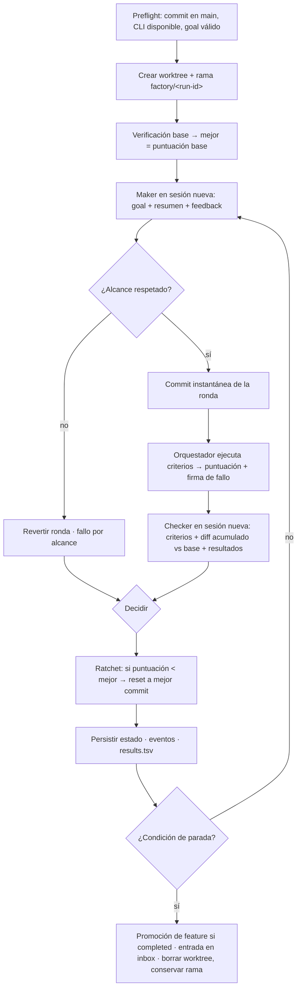

# Design

## Context

- **Repositorio vacío.** Solo contiene el `main.py` de ejemplo de PyCharm. No hay `pyproject`, tests, lint ni commits (`main` no tiene HEAD). OpenSpec está inicializado y sin specs.
- **Entorno local.** Python 3.15. No hay `uv`, `ruff` ni `pytest` instalados.
- **Claude Code 2.1.308.** Sin `/goal` nativo, pero con modo headless: `-p`, `--output-format json`, `--json-schema`, `--append-system-prompt`, `--model`, `--allowedTools`/`--disallowedTools`, `--permission-mode`, `--max-budget-usd`, `--no-session-persistence` y `-w/--worktree`.
- **Decisiones del usuario.**
  - Implementación por fases: primero el harness del repo y después el CLI `factory` reutilizable.
  - El loop lo dirige un orquestador Python que invoca `claude -p`.
  - Motivación: ver `proposal.md`. Requisitos: ver `specs/`.

## Goals / Non-Goals

**Goals:**
- **Dogfooding.** La fase 1 deja un harness con el que se construye la fase 2: las features del motor viven en `feature_list.json`, y el propio harness verifica y promueve cada una.
- **Decisiones deterministas.** Las decisiones de control (verificar, aprobar, revertir, parar) viven en código Python determinista y testeable, no en prompts.
- **Tests sin red ni coste.** Todo el comportamiento de las specs se prueba con un agente simulado.
- **Coste cero en reposo.** Un tick sin problemas no invoca agentes.

**Non-Goals:**
- Sandbox de seguridad (contenedores o VM) para los agentes. Se documenta como recomendación para ejecuciones desatendidas.
- Reanudar una ejecución interrumpida desde su última ronda. El estado queda consistente y marcado `interrupted`, y se puede relanzar el objetivo.
- Comprobación de tipos (mypy) en la ruta de verificación inicial.
- Paralelismo de varias ejecuciones sobre el mismo objetivo (WIP=1 por objetivo).

## Decisions

### D1. Orquestador Python + `claude -p` detrás de una interfaz de agente
El loop es un proceso Python que, en cada ronda, lanza subprocesos `claude -p`: uno para el maker y otro para el checker. Todas las invocaciones pasan por una interfaz `AgentRunner` con tres implementaciones:
- `ClaudeCodeRunner`: la real.
- `FakeRunner`: guionizada, para los tests.
- Futuras, por ejemplo Codex. No entran en este cambio.

- *Alternativa: solo primitivas de Claude Code* (`/loop`, subagentes, hooks). Se descarta porque la condición de parada y la aprobación quedarían en manos del agente, que es justo lo que L09 y L13 piden externalizar.
- *Alternativa: Claude Agent SDK.* Se descarta por decisión del usuario. Además añade una dependencia y configuración de credenciales; el CLI ya aporta presupuesto, esquema de salida y permisos.

### D2. Contrato de invocación por rol
```
claude -p "<entrada de la ronda>" \
  --output-format json --no-session-persistence \
  --model <rol.model> --append-system-prompt "<prompts/<rol>.md>" \
  --allowedTools <rol.allowed> --disallowedTools <rol.denied> \
  --permission-mode <rol.permission_mode> \
  --max-budget-usd <presupuesto restante de la ejecución> \
  --json-schema <esquema del informe del rol>
```

- **cwd y sesión.** El cwd es el worktree de la ejecución. Cada invocación es una sesión nueva: no se usa `--resume`, lo que acota los tokens.
- **Salida.** Del JSON resultante se extraen el resultado, `total_cost_usd`, `usage`, `num_turns` e `is_error`.
- **Maker.**
  - `permission_mode = acceptEdits`.
  - Herramientas: Read, Edit, Write, Glob y Grep, más Bash limitado a los comandos de verificación y a `git status`/`git diff`.
  - Denegado: `git commit|push|reset|checkout|rebase`, `gh`, despliegues y edición de `feature_list.json`.
  - Su informe estructurado (`summary`, `changed_files`, `self_check`, `risks`, `status: done|in_progress|needs_human`, `question`) permite detectar el bloqueo humano sin heurísticas de texto.
- **Checker.**
  - Herramientas: solo Read, Glob y Grep. Sin Bash: la verificación la ejecuta el orquestador y le pasa los resultados.
  - Entrada: el diff acumulado desde el commit base de la ejecución (`git diff <base>..HEAD`), con el diff de la ronda como contexto adicional. Así una ronda final pequeña no oculta problemas que introdujeron rondas anteriores, como tests debilitados o cambios fuera de alcance.
  - El veredicto se vuelve a validar localmente contra el esquema, con un validador mínimo propio y sin depender de `jsonschema`.
  - Antes y después de cada invocación se compara el hash del árbol (`git status --porcelain` + `git diff`) para detectar escrituras.
- **Prohibición.** Nunca se usa `bypassPermissions` ni `--dangerously-skip-permissions`.
- **Modelos por defecto.** Maker `sonnet` y checker `opus`. Son alias que Claude Code resuelve al modelo vigente. Que sean distintos aplica la recomendación de L13; los dos se pueden configurar.

### D3. Algoritmo de ronda


- **Aprobación.** Criterios al 100 % y checker en `pass`, o en `pass_with_minor` sin hallazgos `critical` ni `medium`. Las aprobaciones consecutivas se cuentan hasta `consecutive_passes`.
- **Firma de fallo.** Es el hash de los nombres de criterios fallidos más las últimas líneas de su salida, normalizadas (sin números, rutas temporales ni tiempos). Si se repite durante `no_progress_rounds` rondas, el resultado es `stalled`.
- **Códigos de salida:**

  | Código | Resultado |
  |---|---|
  | 0 | `completed` |
  | 2 | `goal`/config inválido |
  | 3 | `stalled` |
  | 4 | `max_rounds` |
  | 5 | `budget_exhausted` |
  | 6 | `blocked` |
  | 7 | `agent_error` |
  | 130 | `interrupted` |

- **Valores por defecto:**
  - `factory goal run`: `max_rounds=8`, `max_budget_usd=5`, `no_progress_rounds=3`, `consecutive_passes=1`, `round_timeout_min=20`, `agent_error_rounds=2`.
  - Tick: `max_rounds=3`, `budget_per_tick=2`, `daily_budget=10`, `circuit_after=3`.
- *Alternativa: que el maker haga sus propios commits.* Se descarta porque el orquestador necesita controlar las instantáneas para el ratchet y las reversiones.

### D4. Formato de `goal.md`: frontmatter YAML + cuerpo Markdown
Los metadatos verificables van en el frontmatter:
- `id`, `objective`, `mode: finite|monitor` y `feature` (opcional);
- `acceptance[]` con `name` y `run`;
- `scope.allow[]` y `scope.deny[]`;
- `stop{...}` y `roles{...}`, este último opcional.

El cuerpo es la metodología en lenguaje natural, al estilo de `program.md` de autoresearch. Hay una plantilla en `goals/_template.md`, adaptada de la del curso. `feature_list.json` está siempre en `deny` para el maker, porque la promoción es exclusiva del orquestador.

- *Alternativa: `goal.toml` o frontmatter TOML,* sin dependencias. Se descarta por familiaridad: YAML es el formato de frontmatter de skills, agentes y OpenSpec. Coste: dependencia `pyyaml`.

### D5. Estado externo en `.factory/` (ignorado por git, en el repo principal)
```
.factory/
  runs/<run-id>/   state.json · loop-state.md · events.jsonl · goal.md · rounds/<n>/{maker.json,checker.json,verify.log}
  results.tsv      (solo-añadir, todas las ejecuciones)
  inbox/<run-id>.md   (frontmatter status: pending|reviewed)
  ticks/<goal-id>.jsonl · locks/<goal-id>.lock · breakers/<goal-id>.json · spend/<fecha>.json

../<repo>.factory-worktrees/<run-id>/   (temporal, FUERA del árbol del repo; configurable con `worktrees_dir`)
```

- **Por qué fuera del repo.** Claude Code carga los archivos de memoria (`CLAUDE.md`) desde el cwd hacia arriba. Un worktree anidado en `.factory/worktrees/` haría que el maker cargara también el `CLAUDE.md`/`AGENTS.md` del checkout principal. Si la rama los modificó, el maker recibiría dos versiones contradictorias de las instrucciones. Al situarlo en un directorio hermano, el maker solo ve las instrucciones de su rama, y `ruff`/`pytest` no recorren worktrees anidados.

- **Fuente única.** `state.json` es la fuente de verdad. `loop-state.md` se genera a partir de él con el formato de la plantilla del curso. Ambos se escriben de forma atómica (archivo temporal + `os.replace`), así una interrupción no deja estado corrupto.
- **Identificador.** `run-id = AAAAMMDD-HHMMSS-<goal-id>-<4hex>`.
- **Qué se versiona.** Las conclusiones durables (estado de features, progreso) se promueven al repo a través del harness. Los registros operativos quedan fuera de git.
- *Alternativa: versionar el estado del loop.* Se descarta porque provocaría conflictos entre ramas de ejecución y ensuciaría el historial.

### D6. Lista de features gobernada por comandos
- **Formato.** `feature_list.json` sigue la plantilla del curso, con un cambio: `verification` es una lista de comandos y las comprobaciones manuales van aparte, en `manual_checks`.
- **Comandos.** `factory features validate|start|verify` aplican el esquema, WIP=1 y la promoción con evidencia (comando, código, fecha, commit).
- **Integración en la verificación.** `scripts/check.sh` ejecuta `factory doctor`, que incluye `features validate`. Así una promoción manual sin evidencia rompe la verificación del repo.

### D7. Instrucciones: `AGENTS.md` canónico + `CLAUDE.md` que lo importa
- **`AGENTS.md`.** Es un router de 200 líneas o menos con resumen, arranque, verificación, restricciones duras, definición de terminado, cierre de sesión y enlaces.
- **`CLAUDE.md`.** Contiene `@AGENTS.md` y notas propias de Claude Code: cuándo invocar el subagente `checker`.
- **Documentos temáticos** en `docs/harness/`: `verificacion.md`, `features.md`, `sesiones.md` (inicio, cierre, clean state), `loops.md` (uso, anti-patrones, costes silenciosos) y `roles.md`.
- **Subagente.** `.claude/agents/checker.md` define un evaluador interactivo de solo lectura.

### D8. Herramientas y entorno
- **Paquete.** Layout `src/factory/` con `requires-python >=3.12`, punto de entrada `factory = "factory.cli:main"` y `python -m factory`. El CLI usa `argparse`, de la librería estándar.
- **Dependencias.** En tiempo de ejecución, `pyyaml`. En desarrollo, `pytest` y `ruff`.
- **`init.sh`.** Crea `.venv` (con `uv` si existe; si no, `python3 -m venv` + `pip install -e '.[dev]'`) y ejecuta `scripts/check.sh`.
- **`scripts/check.sh`.** Ejecuta `ruff check`, `ruff format --check`, `pytest` y `factory doctor`.
- **Exclusiones.** `ruff` y `pytest` excluyen `.factory/` (estado operativo) por higiene. Los worktrees no necesitan exclusión porque viven fuera del repo (D5).

### D9. Estrategia de pruebas
- **Agente simulado.** `FakeRunner` reproduce guiones por ronda: editar archivos del worktree, devolver informes y veredictos, simular coste, error o timeout.
- **Integración.** Hay tests sobre repos git temporales (`tmp_path`). Cada escenario de las specs se corresponde con al menos un test.
- **Prueba real.** Una prueba `live` opcional, excluida por defecto, ejecuta un objetivo trivial contra `claude -p` con un presupuesto de 0,50 USD o menos. Valida el contrato de D2.

### D10. Programación de ticks
`factory schedule <goal> --every 30m` imprime la línea de cron, una plantilla de `launchd` y el comando `/loop 30m` equivalente. No toca el sistema. El bloqueo usa un archivo con PID y marca de tiempo; se considera obsoleto si el PID no existe o se supera `round_timeout × max_rounds`.

## Risks / Trade-offs

- **[Las listas de Bash permitidas funcionan por prefijo y no son un sandbox]** → Worktree aislado, comandos de publicación denegados y nunca `bypassPermissions`. Para ejecuciones desatendidas largas se recomienda, en `docs/harness/loops.md`, usar un contenedor o VM.
- **[Coste descontrolado]** → Límites en cuatro niveles: `--max-budget-usd` por invocación, presupuesto por ejecución, por tick y por día. Se suma un cortacircuitos tras K ticks fallidos.
- **[El checker es complaciente o comparte sesgos con el maker]** → La verificación determinista es una puerta obligatoria, independiente del checker. Se usa un modelo distinto por defecto, un prompt adversarial ("no encontrar problemas es tu fallo"), validación del veredicto y revisión humana en el inbox.
- **[Goodhart: el loop optimiza los comandos y no la intención; por ejemplo, debilitando tests]** → `scope.deny` puede proteger los tests existentes. El checklist del checker pregunta explícitamente si se debilitaron o eliminaron tests. Nunca hay merge automático.
- **[Explosión de tokens]** → Sesión nueva por ronda, resumen de estado con tamaño máximo y alerta de tendencia en `factory status`.
- **[Deterioro de comprensión y rendición cognitiva]** → El inbox resume qué cambió y por qué. `factory status` avisa cuando el inbox acumula entradas. La rama solo se integra por decisión humana.
- **[Worktrees huérfanos fuera del repo tras una caída del proceso]** → Al arrancar, el preflight ejecuta `git worktree prune` y detecta los directorios de ejecuciones que ya no están activas. `factory status` los lista para limpiarlos.
- **[Denegaciones de herramientas no visibles en la salida JSON del CLI]** → La spec solo promete la denegación. La prueba `live` (9.2) comprueba si el resultado expone las herramientas denegadas, para registrarlas en `events.jsonl` cuando sea posible.
- **[La forma de la salida con `--json-schema` puede variar entre versiones del CLI]** → La prueba `live` fija el contrato. El adaptador acepta el campo estructurado o, si no existe, un JSON dentro de `result`, y en cualquier otro caso trata la salida como inválida.

## Migration Plan

Es un proyecto nuevo y no hay nada que migrar. Orden de despliegue:

1. Con aprobación del usuario: `.gitignore` y commit inicial. Sin commit no hay worktrees.
2. Fase 1 (harness).
3. Fase 2 (motor), feature a feature, bajo el propio harness.

Rollback: los loops nunca integran en `main`. Basta con borrar la rama `factory/<run-id>` y el directorio `.factory/`.

## Open Questions

- ¿En qué campo exacto devuelve el CLI la salida validada por `--json-schema` en esta versión? Se resuelve con la prueba `live`; no cambia el diseño gracias al respaldo de D2/Riesgos.
- ¿Conviene ajustar los modelos por defecto de cada rol tras las primeras ejecuciones reales? Es configuración, no comportamiento.
- ¿Qué nombre/etiqueta usar en la plantilla de `launchd`? Se decide al implementar D10.
